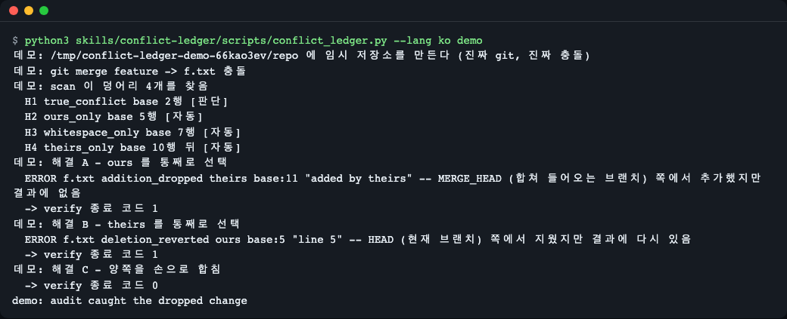
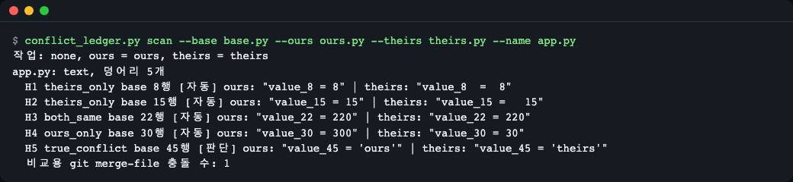
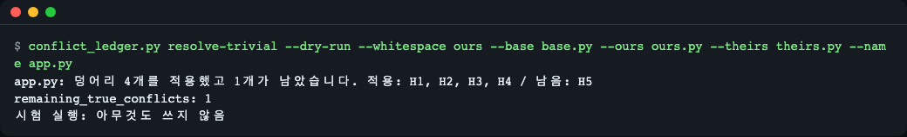
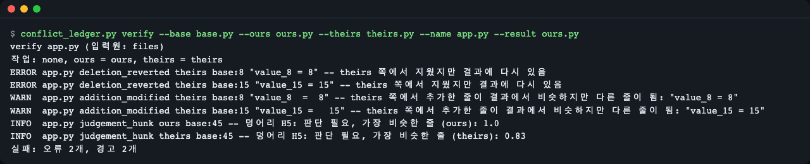
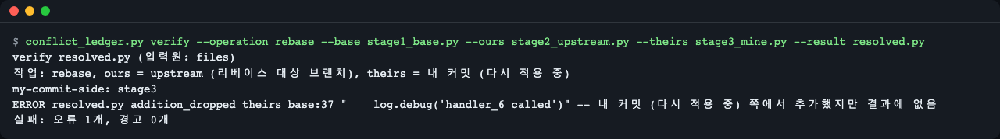
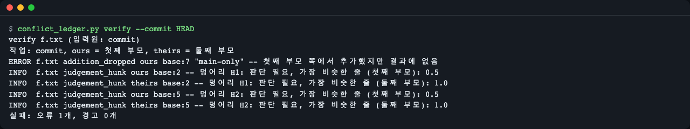
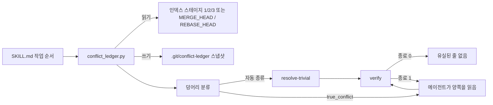

# conflict-ledger

[English](README.md) | **한국어**

git merge·rebase·cherry-pick 충돌을 위한 에이전트 스킬입니다. 코딩 에이전트가 충돌을 풀면, 번들 Python 스크립트가 모든 덩어리(hunk)를 공통 조상(병합 기준점, base)에 대조해 분류하고, 결과가 양쪽 변경을 줄 단위로 모두 남겼는지 검사합니다. 해결 결과가 테스트를 통과해도 한쪽 작업이 조용히 사라질 수 있는데, 이 감사가 커밋 전에 그것을 잡습니다.

현재 버전: 0.1.3 — [CHANGELOG.md](CHANGELOG.md) 참고.


*`demo` 는 진짜 충돌이 있는 임시 저장소를 만듭니다. "ours"나 "theirs"를 통째로 고르면 종료 코드 1, 양쪽을 합치면 0 입니다.*

## What it does (무엇을 하나)
- **덩어리 분류**: 3-way(diff3) 모델로 `ours_only`, `theirs_only`, `both_same`, `whitespace_only`, `both_added_same_point`, `true_conflict` 로 나눕니다. 입력은 인덱스 스테이지 1/2/3 에서 읽으므로 진짜 base·ours·theirs 를 씁니다.
- **증명 가능한 것만 자동 해결**: `resolve-trivial` 은 앞의 네 종류만 풀고, 진짜 충돌은 diff3 표식 블록(`<<<<<<<` / `|||||||` / `=======` / `>>>>>>>`)으로 남깁니다. 인덱스는 건드리지 않습니다.
- **결과 감사**: `verify` 는 base→ours, base→theirs 의 줄 변경 집합을 해결 파일과 대조합니다. 빠진 추가(`addition_dropped`), 되살아난 삭제(`deletion_reverted`), 손대지 않았는데 사라진 줄(`base_line_lost`), 남은 표식(`conflict_marker_left`)을 찾습니다. 종료 코드: 0 통과, 1 오류, 2 경고만, 3 입력 문제.
- **진짜 쪽 이름 표시**: 리베이스에서는 "ours"가 upstream 브랜치이고 "theirs"가 내 커밋입니다. 출력이 이를 직접 알려 줍니다.

## Install (설치)
**Claude Code**
```
/plugin marketplace add LeeGyeongPil/conflict-ledger
/plugin install conflict-ledger@conflict-ledger-skill
```
**Agent Skills 표준을 읽는 다른 에이전트** — `skills/conflict-ledger` 를 에이전트의 스킬 폴더(예: 프로젝트의 `.agents/skills/`)로 복사합니다.

**Codex CLI** — `skills/conflict-ledger` 를 프로젝트의 `.agents/skills/` 로 복사합니다.

필요한 것: Python 3.10+ (표준 라이브러리만)와 git 2.35+. 네트워크는 쓰지 않습니다. 깨끗한 Debian·Ubuntu 이미지에서는 `apt-get install -y git python3`.

## 30초 체험
스킬 설치 없이 clone 해서 데모를 돌리면 됩니다(데모가 임시 git 저장소를 직접 만듭니다).

```
git clone https://github.com/LeeGyeongPil/conflict-ledger.git
cd conflict-ledger
python3 skills/conflict-ledger/scripts/conflict_ledger.py demo --lang ko
```

```
데모: /tmp/conflict-ledger-demo-0tajws9o/repo 에 임시 저장소를 만든다 (진짜 git, 진짜 충돌)
데모: git merge feature -> f.txt 충돌
데모: scan 이 덩어리 4개를 찾음
  H1 true_conflict base 2행 [판단]
  H2 ours_only base 5행 [자동]
  H3 whitespace_only base 7행 [자동]
  H4 theirs_only base 10행 뒤 [자동]
데모: 해결 A - ours 를 통째로 선택
  ERROR f.txt addition_dropped theirs base:11 "added by theirs" -- MERGE_HEAD (합쳐 들어오는 브랜치) 쪽에서 추가했지만 결과에 없음
  -> verify 종료 코드 1
데모: 해결 B - theirs 를 통째로 선택
  ERROR f.txt deletion_reverted ours base:5 "line 5" -- HEAD (현재 브랜치) 쪽에서 지웠지만 결과에 다시 있음
  -> verify 종료 코드 1
데모: 해결 C - 양쪽을 손으로 합침
  -> verify 종료 코드 0
demo: audit caught the dropped change
```

임시 폴더 이름은 실행마다 다릅니다. 해결 B 에는 충돌 표식이 하나도 남아 있지 않고 `line 5` 는 충돌 블록 밖에 있으므로, 표식만 읽어서는 문제가 보이지 않습니다. 마지막 줄은 성공 표식이라 두 언어에서 같습니다.

## Use it (사용법)
에이전트에게 평소 말투로 요청하면 됩니다. 아래는 이 스킬이 실제로 발동하는지 평가하는 요청들입니다.

- "I just resolved the merge conflicts in src/config.py - can you check I didn't lose anything from either branch?" (영어: 방금 src/config.py 의 병합 충돌을 풀었는데 양쪽 브랜치에서 빠진 게 없는지 확인해 줘.)
- "Cherry-pick hit a conflict in handlers.go - resolve it safely." (영어: 체리픽에서 handlers.go 충돌이 났어, 안전하게 풀어 줘.)
- "병합 충돌 해결했는데 한쪽 변경이 빠진 거 없는지 확인해 줘."

에이전트의 첫 단계는 언제나 스크립트 호출 하나입니다: `status --json`, 파일이나 병합 커밋을 주면 `verify ... --json`. 바이너리 파일·추가/추가·수정/삭제 충돌·없는 파일도 이 호출이 판정하므로, 에이전트는 확장자를 보고 짐작하지 않고 스크립트의 판정을 그대로 전합니다. 이 호출이 검사할 것이 없다고 알리면(종료 3, 또는 진행 중인 충돌 없음) 에이전트는 그 사실을 알리고 멈춥니다. 병합은 진행 중인데 모든 파일을 이미 풀고 스테이징했다면 바로 `verify` 로 갑니다. 그렇지 않으면 `scan`, `resolve-trivial` 을 돌리고, 진짜 충돌은 직접 풀고, `verify` 가 0 으로 끝날 때까지 반복합니다. 같은 명령을 손으로 돌릴 수도 있습니다. 종료 코드는 모든 명령에서 같습니다.

| 코드 | 뜻 |
|---|---|
| 0 | 통과: 유실된 변경 없음 |
| 1 | 오류: 변경이 사라졌거나 충돌 표식이 남음(추가/추가처럼 줄 감사를 건너뛰는 파일도 포함) |
| 2 | 경고만: 사람이 한번 볼 것 |
| 3 | 쓸 수 없는 입력: 바이너리 파일, 없는 파일, 감사할 대상 없음 등([입력 문제](#입력-문제-종료-3) 참고) |

아래는 `evals/fixtures/` 의 예제 파일로 하는 파일 모드(저장소 불필요) 따라 하기입니다. 충돌 중인 저장소 안에서는 파일 옵션을 빼면 됩니다.

```
F=evals/fixtures/task-trivial-then-judge
python3 skills/conflict-ledger/scripts/conflict_ledger.py --lang ko scan --base $F/base.py --ours $F/ours.py --theirs $F/theirs.py --name app.py
```

```
작업: none, ours = ours, theirs = theirs
app.py: text, 덩어리 5개
  H1 theirs_only base 8행 [자동] ours: "value_8 = 8" | theirs: "value_8  =  8"
  H2 theirs_only base 15행 [자동] ours: "value_15 = 15" | theirs: "value_15 =   15"
  H3 both_same base 22행 [자동] ours: "value_22 = 220" | theirs: "value_22 = 220"
  H4 ours_only base 30행 [자동] ours: "value_30 = 300" | theirs: "value_30 = 30"
  H5 true_conflict base 45행 [판단] ours: "value_45 = 'ours'" | theirs: "value_45 = 'theirs'"
  비교용 git merge-file 충돌 수: 1
```


*`[자동]` 덩어리는 기계가 안전하게 풀 수 있고, `[판단]` 덩어리는 사람(또는 에이전트)이 읽어야 합니다.*

`[자동]` 네 개를 풀고 H5 는 표식 블록으로 남깁니다.

```
python3 skills/conflict-ledger/scripts/conflict_ledger.py --lang ko resolve-trivial --base $F/base.py --ours $F/ours.py --theirs $F/theirs.py --name app.py --out /tmp/partial.py
```

```
app.py: 덩어리 4개를 적용했고 1개가 남았습니다. 적용: H1, H2, H3, H4 / 남음: H5
remaining_true_conflicts: 1
저장함: /tmp/partial.py (인덱스는 바꾸지 않음)
```


*`--dry-run` 을 주면 같은 보고만 출력하고 아무것도 쓰지 않습니다.*

H5 를 손으로 합친 뒤(여기서는 `/tmp/partial.py` 의 표식 블록을 `value_45 = 'ours_theirs'` 한 줄로 바꿔 `/tmp/merged.py` 로 저장합니다. 다른 줄을 쓰면 유사도 숫자가 달라집니다) 감사합니다.

```
python3 skills/conflict-ledger/scripts/conflict_ledger.py --lang ko verify --base $F/base.py --ours $F/ours.py --theirs $F/theirs.py --name app.py --result /tmp/merged.py
```

```
verify app.py (입력원: files)
작업: none, ours = ours, theirs = theirs
INFO  app.py judgement_hunk ours base:45 -- 덩어리 H5: 판단 필요, 가장 비슷한 줄 (ours): 0.83
INFO  app.py judgement_hunk theirs base:45 -- 덩어리 H5: 판단 필요, 가장 비슷한 줄 (theirs): 0.88
통과: 유실된 변경 없음 (판단이 필요한 덩어리 1개)
```

INFO 두 줄은 같은 덩어리 H5 의 양쪽 몫이라 덩어리 수는 1개입니다.

반대로 `ours.py` 를 통째로 결과로 쓰면 "theirs"만 바꾼 내용이 사라지고 `verify` 는 1 로 끝납니다.

```
python3 skills/conflict-ledger/scripts/conflict_ledger.py --lang ko verify --base $F/base.py --ours $F/ours.py --theirs $F/theirs.py --name app.py --result $F/ours.py
```

```
verify app.py (입력원: files)
작업: none, ours = ours, theirs = theirs
ERROR app.py deletion_reverted theirs base:8 "value_8 = 8" -- theirs 쪽에서 지웠지만 결과에 다시 있음
ERROR app.py deletion_reverted theirs base:15 "value_15 = 15" -- theirs 쪽에서 지웠지만 결과에 다시 있음
WARN  app.py addition_modified theirs base:8 "value_8  =  8" -- theirs 쪽에서 추가한 줄이 결과에서 비슷하지만 다른 줄이 됨: "value_8 = 8"
WARN  app.py addition_modified theirs base:15 "value_15 =   15" -- theirs 쪽에서 추가한 줄이 결과에서 비슷하지만 다른 줄이 됨: "value_15 = 15"
INFO  app.py judgement_hunk ours base:45 -- 덩어리 H5: 판단 필요, 가장 비슷한 줄 (ours): 1.0
INFO  app.py judgement_hunk theirs base:45 -- 덩어리 H5: 판단 필요, 가장 비슷한 줄 (theirs): 0.83
실패: 오류 2개, 경고 2개
```


*각 줄이 종류, 쪽, base 줄 번호, 사라진 텍스트를 알려 줍니다.*

### 리베이스 라벨
리베이스에서는 git 이 두 쪽의 의미를 맞바꿉니다. 출력이 어느 쪽이 무엇인지 적어 줍니다.

```
F=evals/fixtures/task-rebase-labels
python3 skills/conflict-ledger/scripts/conflict_ledger.py --lang ko verify --operation rebase --name resolved.py --base $F/stage1_base.py --ours $F/stage2_upstream.py --theirs $F/stage3_mine.py --result $F/resolved.py
```

```
verify resolved.py (입력원: files)
작업: rebase, ours = upstream (리베이스 대상 브랜치), theirs = 내 커밋 (다시 적용 중)
my-commit-side: stage3
ERROR resolved.py addition_dropped theirs base:37 "    log.debug('handler_6 called')" -- 내 커밋 (다시 적용 중) 쪽에서 추가했지만 결과에 없음
실패: 오류 1개, 경고 0개
```


*사라진 줄이 내 커밋에서 온 것이고, 리베이스 중에는 그쪽이 "theirs"입니다.*

### 저장소 안에서
`--out` 없이 `resolve-trivial f.txt` 를 돌리면 작업 파일을 해결된 덩어리와 diff3 표식으로 다시 쓰고, 표식 이름은 git 이 쓴 것(`HEAD`, 병합한 브랜치 이름, `merge.conflictStyle` 이 `diff3` 이면 base 라벨, 아니면 `base`)을 그대로 씁니다. `git merge feature` 가 충돌 블록 두 개와 `main` 만 더한 줄 하나를 남긴 뒤의 실제 실행:

```
python3 skills/conflict-ledger/scripts/conflict_ledger.py --lang ko resolve-trivial f.txt
```

```
f.txt: 덩어리 1개를 적용했고 2개가 남았습니다. 적용: H3 / 남음: H1, H2
remaining_true_conflicts: 2
저장함: /tmp/.../repo/f.txt (인덱스는 바꾸지 않음)
```

```
a
<<<<<<< HEAD
B-main
||||||| base
b
=======
B-feat
>>>>>>> feature
c
...
```

단, 파일이 git 이 쓴 충돌 상태 그대로일 때만 씁니다(세 인덱스 스테이지를 git 이 직접 병합한 결과와 대조하며, `merge.conflictStyle` 과 상관없이 동작). 덩어리 하나라도 이미 풀었거나, 줄을 추가·수정했거나, 파일 전체를 해결했다면 거부하고(종료 3) 아무것도 쓰지 않습니다. 충돌 블록 두 개 중 하나를 손으로 풀고 줄 하나를 더한 파일에서의 실제 출력:

```
python3 skills/conflict-ledger/scripts/conflict_ledger.py --lang ko resolve-trivial f.txt
```

```
/tmp/.../repo/f.txt: 세 버전의 미해결 충돌 상태와 다름(덩어리를 풀었거나 줄을 추가·수정함). 손으로 고친 내용을 잃지 않도록 덮어쓰지 않음(아무것도 쓰지 않음). 손으로 마저 고친 뒤 verify 로 검사하거나, --out FILE 로 기계 해결본을 다른 곳에 쓰거나, 고친 내용을 버리고 덮어쓰려면 --force 를 줄 것
```

이런 파일은 손으로 마저 풀고 바로 `verify` 하세요. `--out FILE` 은 기계 해결본을 다른 파일에 쓰고(경로 하나), `--force` 는 고친 내용을 정말 버릴 때만 씁니다.

**다 풀고 스테이징했지만 아직 커밋 전.** 모든 파일을 풀고 `git add` 까지 했어도 PATH 없는 `verify` 는 병합을 감사합니다. 병합되지 않은 파일도 스냅샷도 없으면 병합 기준점·`HEAD`·`MERGE_HEAD` 에서 base·ours·theirs 를 읽어, 양쪽이 모두 바꾼 파일을 전부 검사합니다. 실제 실행: 양쪽이 `b`·`e` 줄을 바꿨고 `main` 은 `main-only` 줄도 더했는데, `feature` 쪽 파일을 그대로 베껴 해결하고 `git add f.txt` 한 상태입니다.

```
python3 skills/conflict-ledger/scripts/conflict_ledger.py --lang ko status
```

```
작업: merge
스테이지 2 (ours) = HEAD (현재 브랜치)
스테이지 3 (theirs) = MERGE_HEAD (합쳐 들어오는 브랜치)
병합되지 않은 파일 없음
병합되지 않은 파일이 남지 않음, PATH 없는 verify 가 양쪽이 모두 바꾼 파일을 감사함: f.txt
저장된 스냅샷 없음
```

```
python3 skills/conflict-ledger/scripts/conflict_ledger.py --lang ko verify
```

```
verify f.txt (입력원: heads)
작업: merge, ours = HEAD (현재 브랜치), theirs = MERGE_HEAD (합쳐 들어오는 브랜치)
ERROR f.txt addition_dropped ours base:7 "main-only" -- HEAD (현재 브랜치) 쪽에서 추가했지만 결과에 없음
INFO  f.txt judgement_hunk ours base:2 -- 덩어리 H1: 판단 필요, 가장 비슷한 줄 (HEAD (현재 브랜치)): 0.5
INFO  f.txt judgement_hunk theirs base:2 -- 덩어리 H1: 판단 필요, 가장 비슷한 줄 (MERGE_HEAD (합쳐 들어오는 브랜치)): 1.0
INFO  f.txt judgement_hunk ours base:5 -- 덩어리 H2: 판단 필요, 가장 비슷한 줄 (HEAD (현재 브랜치)): 0.5
INFO  f.txt judgement_hunk theirs base:5 -- 덩어리 H2: 판단 필요, 가장 비슷한 줄 (MERGE_HEAD (합쳐 들어오는 브랜치)): 1.0
실패: 오류 1개, 경고 0개
```

- `입력원: heads` 는 세 버전을 인덱스 스테이지가 아니라 커밋에서 읽었다는 뜻입니다.
- 종료 코드가 1 이니 아직 커밋하지 마세요. `main-only` 를 되살리고 다시 `git add` 한 뒤 `verify` 를 다시 돌립니다.
- PATH 없는 감사는 양쪽이 모두 바꾼 파일만 다룹니다. 한쪽만 바꾼 파일은 이름을 주어 확인합니다: `verify PATH`.
- 병합이 진행 중인데 감사할 대상을 하나도 찾지 못하면, "진행 중인 충돌 없음"이라고 하지 않고 종류 `nothing_to_audit` 로 종료 3 을 냅니다.

### 기존 병합 커밋 감사
`verify --commit SHA` 는 이미 만들어진 병합 커밋을 감사합니다. 커밋의 트리를 첫째 부모(ours)·둘째 부모(theirs)·둘의 병합 기준점과 대조하고, 작업 트리와 인덱스는 건드리지 않습니다. 위와 같은 병합을 고치지 않고 커밋한 상태에서의 실제 실행:

```
python3 skills/conflict-ledger/scripts/conflict_ledger.py --lang ko verify --commit HEAD
```

```
verify f.txt (입력원: commit)
작업: commit, ours = 첫째 부모, theirs = 둘째 부모
ERROR f.txt addition_dropped ours base:7 "main-only" -- 첫째 부모 쪽에서 추가했지만 결과에 없음
INFO  f.txt judgement_hunk ours base:2 -- 덩어리 H1: 판단 필요, 가장 비슷한 줄 (첫째 부모): 0.5
INFO  f.txt judgement_hunk theirs base:2 -- 덩어리 H1: 판단 필요, 가장 비슷한 줄 (둘째 부모): 1.0
INFO  f.txt judgement_hunk ours base:5 -- 덩어리 H2: 판단 필요, 가장 비슷한 줄 (첫째 부모): 0.5
INFO  f.txt judgement_hunk theirs base:5 -- 덩어리 H2: 판단 필요, 가장 비슷한 줄 (둘째 부모): 1.0
실패: 오류 1개, 경고 0개
```


*커밋 감사에서 "ours"는 첫째 부모(원래 있던 브랜치), "theirs"는 둘째 부모(합쳐 들어온 브랜치)입니다.*

병합 커밋이 `main-only` 를 남겼다면 같은 명령은 `통과:` 줄과 종료 코드 0 으로 끝납니다. 부모가 하나인 커밋(보통 커밋, 또는 fast-forward 병합의 결과)은 병합이 아니라 감사할 것이 없습니다. 스크립트는 stderr 에 그렇게 적고 종류 `not_two_parent` 로 종료 3 을 냅니다.

```
python3 skills/conflict-ledger/scripts/conflict_ledger.py --lang ko verify --commit HEAD~1
```

```
커밋 HEAD~1 은 부모가 2개인 병합 커밋이 아님
```

한쪽 부모가 파일 이름을 바꾸고 다른 쪽이 옛 이름에서 내용을 고쳤다면 git 은 이름 바꾸기 감지로 둘을 합치고, 감사도 같은 짝으로 비교합니다. 새 경로를 base 와 이름을 바꾸지 않은 쪽의 옛 경로에 대조하고, 옛 경로를 알려 주는 `INFO ... rename_followed` 줄을 덧붙입니다.

### 입력 문제 (종료 3)
줄 감사를 할 수 없는 입력이어도 스크립트는 호출 한 번으로 답합니다. 이유는 stderr 한 줄로 나오고, `--json` 이면 stdout 에 장부로도 나오며, `--findings-file FILE` 이면 파일에 `input_error <kind> <path>` 와 `summary: exit=3 input_error=<kind>` 가 쓰입니다. 바이너리는 파일 이름과 상관없이 내용(NUL 바이트 또는 잘못된 UTF-8)으로 판정합니다. 바이너리 파일 이름이 `*.txt` 인 평가 픽스처에서의 실제 실행:

```
F=evals/fixtures/task-error-disguised-binary
python3 skills/conflict-ledger/scripts/conflict_ledger.py --lang ko verify --base $F/export_base.txt --ours $F/export_ours.txt --theirs $F/export_theirs.txt --result $F/export.txt --json
```

```
{
  "ok": false,
  "exit_code": 3,
  "input_error": {
    "kind": "binary",
    "path": "evals/fixtures/task-error-disguised-binary/export_base.txt",
    "message": "바이너리 파일, 줄 감사 건너뜀: evals/fixtures/task-error-disguised-binary/export_base.txt, 텍스트 파일을 주거나 직접 비교할 것"
  }
}
```

다른 종류로 `not_a_repo`, `no_conflict`, `nothing_to_audit`, `file_missing`, `not_two_parent`, `hand_edited` 등이 있습니다(전체 표: [references/classes.md](skills/conflict-ledger/references/classes.md)). `kind` 와 `path` 는 언어와 상관없이 같습니다. 검사할 저장소가 아니라 스킬 자체 폴더 안에서 실행하면 저장소를 읽는 명령은 모두 `skill_folder` 로 멈추므로, 에이전트가 설치된 플러그인의 git 클론을 사용자 저장소로 착각하지 않습니다. `status --json` 은 병합되지 않은 경로마다 종류를 `unmerged_kinds` 로 알려 줍니다(`text`, `binary`, `add_add`, `modify_delete`, `symlink`).

### 발견 항목
`verify` 와 `scan` 이 내는 종류입니다(쪽 이름 표 포함 전체: [skills/conflict-ledger/references/classes.md](skills/conflict-ledger/references/classes.md)).

| 발견 | 수준 | 뜻 |
|---|---|---|
| `addition_dropped` | 오류 | 한쪽이 추가한 줄이 결과에 없음 |
| `deletion_reverted` | 오류 | 한쪽이 지운 base 줄이 결과에 다시 있음 |
| `base_line_lost` | 오류 | 아무도 바꾸지 않은 base 줄이 없어지거나 바뀜 |
| `conflict_marker_left` | 오류 | 충돌 표식이 결과에 남아 있음 |
| `addition_modified` | 경고 | 추가한 줄은 없지만 비슷한 줄이 근처에 있음 |
| `side_discarded` | 경고 | 판단 덩어리에서 한쪽 변경과 비슷한 것이 하나도 남지 않음 |
| `new_line_introduced` | 경고 | 판단 덩어리 밖에 어느 쪽도 쓰지 않은 줄이 생김 |
| `multiple_merge_bases` | 경고 | 병합 기준점이 여러 개라 첫 번째를 사용함 |
| `judgement_hunk` | 정보 | 판단이 필요했던 덩어리와 결과가 각 쪽에 얼마나 가까운지 |
| `rename_followed` | 정보 | `verify --commit` 이 이름이 바뀐 파일을 옛 경로에 대조해 감사함 |

### 명령
| 명령 | 하는 일 | 옵션 (`--help` 기준) |
|---|---|---|
| `status` | 진행 중인 작업과 스테이지 2·3 의 의미, (`--json` 이면) 병합되지 않은 경로별 종류를 보여 줌 | 공통 옵션만 |
| `scan [PATH ...]` | 병합되지 않은 파일의 덩어리를 분류하고 스냅샷 저장 | `--base` `--ours` `--theirs` `--name` `--operation {merge,rebase,cherry-pick,revert}` |
| `resolve-trivial [PATH ...]` | 증명 가능한 사소한 덩어리만 풀고 진짜 충돌은 diff3 표식으로 남김 | 위 파일 모드 옵션 + `--out FILE` `--force` `--dry-run` `--findings-file FILE` `--whitespace {ours,theirs}` |
| `verify [PATH ...]` | 해결 결과를 base 와 양쪽 변경에 대조해 감사. PATH 가 없으면 병합되지 않은 파일, 저장된 스냅샷, (모두 스테이징한 뒤에는) 양쪽이 모두 바꾼 파일을 감사 | 위 파일 모드 옵션 + `--result FILE` `--commit SHA` `--ignore-whitespace` `--findings-file FILE` |
| `demo` | 임시 저장소에서 처음부터 끝까지 시연 | `--keep` |

공통 옵션(명령 앞뒤 어디든): `--repo PATH`, `--json`, `--lang {en,ko}`, `--eol {normalize,keep}`; 최상위에는 `--version`, `-h`. `verify --commit SHA` 는 이미 만들어진 병합 커밋(부모 2개)을 감사합니다([기존 병합 커밋 감사](#기존-병합-커밋-감사) 참고).

### 화면 언어
출력은 영어·한국어입니다. `--lang en|ko` > `CONFLICT_LEDGER_LANG` > `LC_ALL` / `LC_MESSAGES` / `LANG` 순이고(`ko` 로 시작하면 한국어, 아니면 영어), `--json` 의 키와 `kind` 값은 언어와 상관없이 같습니다.

## Verified behavior (검증)
<!-- skill-eval:start -->
| 확인 | 결과 |
|---|---|
| 필요할 때 불림 | 12/12 |
| 필요 없을 때 안 불림 | 12/12 |
| 스킬로 푼 작업 | 6/6 |
| 스킬 없이 푼 작업(기준선) | 1/6 |
| 평균 점수 차이(Δ) | +0.52 |
| 가짜 스크립트를 잡아낸 비율 | 6/6 |
| Codex CLI | 작업 6/6 통과 · 확인됨 |

Claude Code 2.1.322 · sonnet · 케이스마다 3회 · 2026-11-14 측정 · codex-cli 0.154.0
<!-- skill-eval:end -->

0.1.3 부터의 평가 범위: 그림 파일(PNG) 네 장만 주던 작업 케이스(`task-error-binary`)를 평가 세트에서 뺐습니다. 공개 전 평가 세 번 연속으로 opus 가 이 케이스에서 한 번 이상 스크립트를 돌리지 않고 그림을 직접 보고 답했고(sonnet·haiku 는 스크립트를 돌림), 그림은 이 스킬이 감사하는 대상이 아닙니다. 스크립트도 `binary`(종료 3)로 알려 줄 뿐입니다. 바이너리 처리는 테스트 묶음(실제 병합에서 텍스트 파일 옆의 바이너리 파일 포함)과, 모든 모델에서 재는 오류 경로 작업 `task-error-disguised-binary`(이름은 `.txt`, 내용은 바이너리)가 계속 확인합니다. 평가는 발동 12개·미발동 12개·작업 6개입니다.

검토 중 확인된 동작(깨끗한 컨테이너와 로컬 실행):
- 테스트가 통과하고(git 태그를 읽는 테스트는 태그 없는 사본에서 건너뜁니다), 이 README의 예시 출력이 실제 실행과 일치합니다.
- `resolve-trivial` 은 이미 일부 또는 전부 손으로 해결한 파일을 거부합니다(종료 코드 3, 아무것도 쓰지 않음). 기존 `--out` 파일은 손으로 편집한 것만 거부하고, 아직 원래 충돌 상태면 덮어씁니다(`--force` 로 강제).
- 리베이스 중에는 git 정의대로 ours/theirs 라벨이 뒤바뀌며(`ours` 는 리베이스 대상 브랜치), 보고서가 어느 쪽인지 밝힙니다.
- `verify --commit` 은 작업 트리를 건드리지 않고 기존 부모 둘짜리 병합 커밋을 검사합니다.
- 같은 입력과 결과는 다시 실행해도 같은 `receipt=` 지문을 냅니다.

## How it works (동작 원리)



1. 에이전트가 `SKILL.md` 를 읽으면 첫 명령(`status --json`, 파일이나 병합 커밋이 주어지면 `verify ... --json`)이 정해지고, 그 명령이 종료 3 이나 진행 중인 충돌 없음을 알리면 거기서 멈춥니다. 그렇지 않으면 순서는 `scan`, `resolve-trivial`, 판단, `verify` 입니다.
2. 스크립트가 인덱스 스테이지(또는 `MERGE_HEAD`, `REBASE_HEAD`, `CHERRY_PICK_HEAD`, `REVERT_HEAD`)에서 base·ours·theirs 를 읽고 스냅샷을 저장하므로 `git add` 뒤에도 `verify` 가 됩니다. 스냅샷이 없으면 병합 기준점과 두 헤드 커밋에서 세 버전을 읽고, `verify --commit` 은 병합 커밋과 그 부모들에서 읽습니다.
3. `difflib`(`autojunk=False`)로 base→ours, base→theirs 를 정렬하고, 맞닿거나 겹치는 변경 구간은 git 처럼 한 덩어리로 묶습니다.
4. `verify` 는 추가된 줄을 "덩어리 앞뒤로 결과에 남은 base 줄 사이 구간"의 다중집합으로, 삭제된 줄을 정렬된 base 위치로 판정하므로 `}` 같은 반복 줄이 유실을 가리지 못합니다.

## When to use it (언제 쓰나)
에이전트(또는 내가) 충돌을 푼 뒤, 충돌 표식 밖의 변경까지 포함해 어느 쪽 변경도 사라지지 않았는지 결정적으로 확인하고 싶을 때 씁니다.

## Limitations (한계)
줄 단위 감사입니다. 종료 0 은 사라진 줄을 못 찾았다는 뜻이지 해결이 옳다는 뜻이 아닙니다. 판단 덩어리(`true_conflict`)는 INFO 유사도로만 보고하므로, 한 줄짜리 `true_conflict` 에서 한쪽 줄만 골라도 줄이 비슷하면 종료 0 으로 통과할 수 있습니다. 의미 판단, 구문 인식 병합, 옥토퍼스 병합, 공식 Windows 지원은 하지 않습니다. 이름 바꾸기는 git 이 경로 짝을 맞춘 곳에서만 따라갑니다. 아직 병합되지 않은 충돌의 인덱스 스테이지, 그리고 git 의 이름 바꾸기 감지가 짝을 확실히 맞추는 `verify --commit`(한쪽만 이름을 바꿨거나 양쪽이 같은 새 이름으로 바꾼 경우)입니다. 양쪽이 서로 다른 이름으로 바꾼 파일은 경로별로 감사하므로 사람이 확인해야 합니다. 이진 파일(내용으로 판정)·추가/추가·진짜 수정/삭제 충돌(한쪽이 파일을 지웠고 그 삭제를 채택한 경우)은 줄 감사를 하지 않습니다. 스크립트가 이유와 함께 알려 주고(종료 3, 또는 `file_skipped` 정보) 사람이 결정합니다. 그래도 이런 파일에 충돌 표식이 남아 있으면 오류(종료 1)이므로, git 이 쓴 그대로 둔 추가/추가 파일은 통과하지 못합니다. 이미지도 스크립트에는 바이너리 파일이라 비교하지 않습니다. 이미지 파일만 주면 에이전트가 스크립트 대신 그림을 직접 볼 수 있는데, 그것은 이 감사가 아닙니다. 어느 쪽도 지우지 않았는데 해결 결과에서 파일이 사라진 경우는 다릅니다. 빈 결과로 감사하므로 양쪽이 추가했거나 함께 유지한 줄이 모두 사라진 것으로 보고합니다(종료 1). 삭제된 경로를 직접 지정해도 `file_missing` 으로 끝나지 않고 그 파일을 감사합니다. difflib 정렬이 git 의 xdiff 와 달라 덩어리 경계가 git 표식과 다를 수 있고, 같은 줄이 연속된 구간에서는 삭제된 줄의 위치가 한 줄 어긋날 수 있습니다.

## Alternatives (대안)
이웃한 일을 하는 다른 도구: [mergiraf](https://mergiraf.org/)(구문 인식 병합 드라이버), [git rerere](https://git-scm.com/docs/git-rerere)(기록한 해결 재사용), 그리고 [warpdotdev/common-skills](https://github.com/warpdotdev/common-skills)·[antinomyhq/forge](https://github.com/antinomyhq/forge) 같은 다른 충돌 해결 스킬. 각 도구가 무엇을 다루는지는 공식 문서를 확인하세요. 이 감사와 함께 쓸 수 있습니다.

## Security notes (보안 참고)
- 스크립트는 셸 없이 고정된 인자 목록으로 `git` 을 실행하고 네트워크를 쓰지 않습니다. 저장소와 지정한 파일만 읽습니다.
- 쓰는 곳은 다음뿐입니다: `.git/conflict-ledger` 아래 스냅샷(`git rev-parse --git-path` 기준), `--out` 없이 `resolve-trivial` 을 돌릴 때의 작업 파일, `--out` 파일, `--findings-file` 파일. 인덱스를 바꾸지 않고 커밋도 하지 않습니다.
- 표준 라이브러리만 쓰므로 스킬을 설치해도 의존성이 늘지 않습니다. 코드를 실행하는 스킬은 믿기 전에 `skills/conflict-ledger/scripts/conflict_ledger.py` 를 읽어 보세요.
- 취약점은 비공개로 신고해 주세요. [SECURITY.md](SECURITY.md) 를 보세요.

## Development (개발)
```
uv sync && uv run pytest -q
```
`evals/` 에는 `claude plugin eval` 형식의 발동 12개·미발동 12개·작업 6개 케이스가 있고(입력은 `evals/fixtures/`), `tools/build_evals.py` 가 다시 만듭니다.

## Changelog (변경 기록)
현재 버전: 0.1.3. 릴리스마다 바뀐 점과 알려진 문제는 [CHANGELOG.md](CHANGELOG.md) 에 있습니다.

## License
MIT
