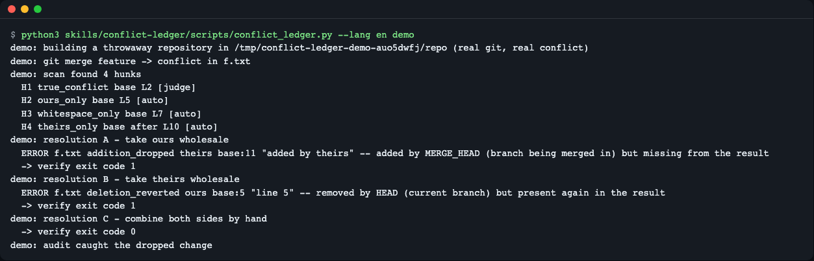
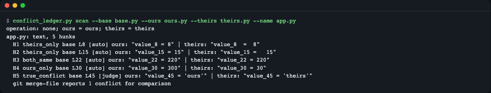
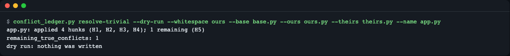
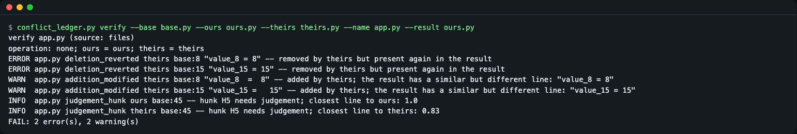
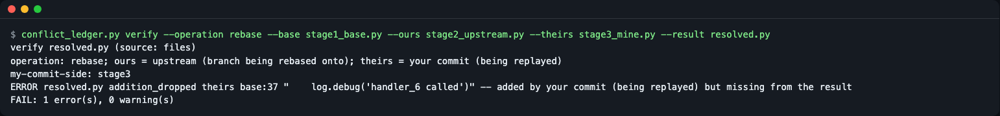
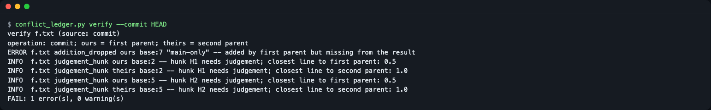
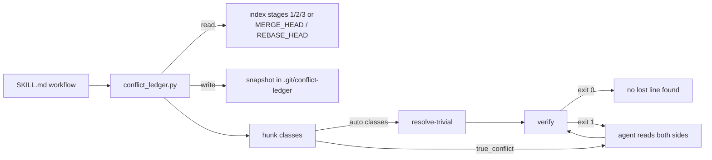

# conflict-ledger

**English** | [한국어](README.ko.md)

An agent skill for git merge, rebase and cherry-pick conflicts. When your coding agent resolves a conflict, the bundled Python script classifies every hunk against the common ancestor (the merge base) and then checks, line by line, that the result kept every change from both sides. A resolution can pass the tests and still silently drop one side's work; this audit catches that before the commit.

Current version: 0.1.1 — see [CHANGELOG.md](CHANGELOG.md).


*`demo` builds a throwaway repository with a real conflict. Taking "ours" or "theirs" wholesale gets exit code 1; combining both sides gets 0.*

## What it does
- **Classifies hunks** with a 3-way (diff3) model: `ours_only`, `theirs_only`, `both_same`, `whitespace_only`, `both_added_same_point`, `true_conflict`. Input comes from the index stages 1/2/3, so it reads the real base, ours and theirs.
- **Resolves only the provable ones.** `resolve-trivial` applies the first four classes and leaves each real conflict as a diff3 marker block (`<<<<<<<` / `|||||||` / `=======` / `>>>>>>>`). It never touches the index.
- **Audits the result.** `verify` compares the line change sets of base to ours and base to theirs with the resolved file: a dropped addition (`addition_dropped`), a reverted deletion (`deletion_reverted`), a lost untouched line (`base_line_lost`), a leftover marker (`conflict_marker_left`). Exit code 0 pass, 1 error, 2 warnings only, 3 unusable input.
- **Names the real sides.** During a rebase, "ours" is the upstream branch and "theirs" is your own commit; the output says so instead of leaving you to guess.

## Install
**Claude Code**
```
/plugin marketplace add LeeGyeongPil/conflict-ledger
/plugin install conflict-ledger@conflict-ledger-skill
```
**Other agents that read the Agent Skills standard** — copy `skills/conflict-ledger` into the agent's skills folder (for example `.agents/skills/` in a project).

**Codex CLI** — copy `skills/conflict-ledger` into `.agents/skills/` of your project.

Requirements: Python 3.10+ (standard library only) and git 2.35+. No network access. Run on a clean Debian or Ubuntu image: `apt-get install -y git python3`.

## Try it in 30 seconds
No skill install needed; clone and run the demo (it builds its own throwaway git repository):

```
git clone https://github.com/LeeGyeongPil/conflict-ledger.git
cd conflict-ledger
python3 skills/conflict-ledger/scripts/conflict_ledger.py demo --lang en
```

```
demo: building a throwaway repository in /tmp/conflict-ledger-demo-qbblti_r/repo (real git, real conflict)
demo: git merge feature -> conflict in f.txt
demo: scan found 4 hunks
  H1 true_conflict base L2 [judge]
  H2 ours_only base L5 [auto]
  H3 whitespace_only base L7 [auto]
  H4 theirs_only base after L10 [auto]
demo: resolution A - take ours wholesale
  ERROR f.txt addition_dropped theirs base:11 "added by theirs" -- added by MERGE_HEAD (branch being merged in) but missing from the result
  -> verify exit code 1
demo: resolution B - take theirs wholesale
  ERROR f.txt deletion_reverted ours base:5 "line 5" -- removed by HEAD (current branch) but present again in the result
  -> verify exit code 1
demo: resolution C - combine both sides by hand
  -> verify exit code 0
demo: audit caught the dropped change
```

The temporary folder name differs on every run. Note that resolution B has no conflict marker left and `line 5` is outside the conflict block, so reading only the markers would not show the problem. The last line is a fixed success marker and is the same in both languages.

## Use it
Ask your agent in plain words. These requests are the kind the skill is evaluated on:

- "I just resolved the merge conflicts in src/config.py - can you check I didn't lose anything from either branch?"
- "Cherry-pick hit a conflict in handlers.go - resolve it safely."
- "병합 충돌 해결했는데 한쪽 변경이 빠진 거 없는지 확인해 줘." (Korean: "I resolved the merge conflict; check that no change from either side is missing.")

The agent's first step is always one script call: `status --json`, or `verify ... --json` when you hand it files or a merge commit. Binary files, add/add and modify/delete conflicts and missing files are judged by that call too, so the agent reports the script's verdict instead of guessing from a file extension; if the call says there is nothing to check (exit 3, or no conflict in progress), the agent tells you and stops. If a merge is in progress but every file is already resolved and staged, it goes straight to `verify`. Otherwise it runs `scan`, `resolve-trivial`, resolves the real conflicts itself, and runs `verify` until it exits 0. You can run the same commands by hand. Exit codes are the same for every command:

| Code | Meaning |
|---|---|
| 0 | pass: no lost change found |
| 1 | error: a change was lost or a conflict marker is left (also in a file whose line audit is skipped, such as add/add) |
| 2 | warnings only: a person should look |
| 3 | unusable input: binary file, missing file, nothing to audit and so on (see [Input problems](#input-problems-exit-3)) |

This walk-through uses the sample files in `evals/fixtures/` (file mode, no repository needed; inside a conflicted repository leave out the file options):

```
F=evals/fixtures/task-trivial-then-judge
python3 skills/conflict-ledger/scripts/conflict_ledger.py --lang en scan --base $F/base.py --ours $F/ours.py --theirs $F/theirs.py --name app.py
```

```
operation: none; ours = ours; theirs = theirs
app.py: text, 5 hunks
  H1 theirs_only base L8 [auto] ours: "value_8 = 8" | theirs: "value_8  =  8"
  H2 theirs_only base L15 [auto] ours: "value_15 = 15" | theirs: "value_15 =   15"
  H3 both_same base L22 [auto] ours: "value_22 = 220" | theirs: "value_22 = 220"
  H4 ours_only base L30 [auto] ours: "value_30 = 300" | theirs: "value_30 = 30"
  H5 true_conflict base L45 [judge] ours: "value_45 = 'ours'" | theirs: "value_45 = 'theirs'"
  git merge-file reports 1 conflict for comparison
```


*`[auto]` hunks are safe for the machine; `[judge]` hunks need a reader.*

Resolve the four `[auto]` hunks and keep H5 as a marker block:

```
python3 skills/conflict-ledger/scripts/conflict_ledger.py --lang en resolve-trivial --base $F/base.py --ours $F/ours.py --theirs $F/theirs.py --name app.py --out /tmp/partial.py
```

```
app.py: applied 4 hunks (H1, H2, H3, H4); 1 remaining (H5)
remaining_true_conflicts: 1
written: /tmp/partial.py (the index was not changed)
```


*With `--dry-run` the same report is printed and nothing is written.*

After you combine H5 by hand (here: replace the marker block in `/tmp/partial.py` with the single line `value_45 = 'ours_theirs'`, saved as `/tmp/merged.py`; a different line gives different similarity numbers), audit it:

```
python3 skills/conflict-ledger/scripts/conflict_ledger.py --lang en verify --base $F/base.py --ours $F/ours.py --theirs $F/theirs.py --name app.py --result /tmp/merged.py
```

```
verify app.py (source: files)
operation: none; ours = ours; theirs = theirs
INFO  app.py judgement_hunk ours base:45 -- hunk H5 needs judgement; closest line to ours: 0.83
INFO  app.py judgement_hunk theirs base:45 -- hunk H5 needs judgement; closest line to theirs: 0.88
PASS: no lost changes found (1 hunk needs judgement)
```

The two INFO lines are one per side of the same hunk H5, so the count is one hunk.

Taking `ours.py` wholesale instead loses the changes that only "theirs" made, and `verify` exits 1:

```
python3 skills/conflict-ledger/scripts/conflict_ledger.py --lang en verify --base $F/base.py --ours $F/ours.py --theirs $F/theirs.py --name app.py --result $F/ours.py
```

```
verify app.py (source: files)
operation: none; ours = ours; theirs = theirs
ERROR app.py deletion_reverted theirs base:8 "value_8 = 8" -- removed by theirs but present again in the result
ERROR app.py deletion_reverted theirs base:15 "value_15 = 15" -- removed by theirs but present again in the result
WARN  app.py addition_modified theirs base:8 "value_8  =  8" -- added by theirs; the result has a similar but different line: "value_8 = 8"
WARN  app.py addition_modified theirs base:15 "value_15 =   15" -- added by theirs; the result has a similar but different line: "value_15 = 15"
INFO  app.py judgement_hunk ours base:45 -- hunk H5 needs judgement; closest line to ours: 1.0
INFO  app.py judgement_hunk theirs base:45 -- hunk H5 needs judgement; closest line to theirs: 0.83
FAIL: 2 error(s), 2 warning(s)
```


*Each line gives the kind, the side, the base line number and the text that went missing.*

### Rebase labels
In a rebase git swaps the meaning of the sides. The output spells out which is which:

```
F=evals/fixtures/task-rebase-labels
python3 skills/conflict-ledger/scripts/conflict_ledger.py --lang en verify --operation rebase --name resolved.py --base $F/stage1_base.py --ours $F/stage2_upstream.py --theirs $F/stage3_mine.py --result $F/resolved.py
```

```
verify resolved.py (source: files)
operation: rebase; ours = upstream (branch being rebased onto); theirs = your commit (being replayed)
my-commit-side: stage3
ERROR resolved.py addition_dropped theirs base:37 "    log.debug('handler_6 called')" -- added by your commit (being replayed) but missing from the result
FAIL: 1 error(s), 0 warning(s)
```


*Here the dropped line came from your own commit, which is the "theirs" side during a rebase.*

### Inside a repository
Run `resolve-trivial f.txt` without `--out` and it rewrites the working file with the resolved hunks and diff3 markers, keeping the marker labels git wrote (`HEAD`, the merged branch name, and the base label when `merge.conflictStyle` is `diff3`; `base` otherwise). Real run after `git merge feature` left two conflict blocks and one line only `main` added:

```
python3 skills/conflict-ledger/scripts/conflict_ledger.py --lang en resolve-trivial f.txt
```

```
f.txt: applied 1 hunk (H3); 2 remaining (H1, H2)
remaining_true_conflicts: 2
written: /tmp/.../repo/f.txt (the index was not changed)
```

```
a
<<<<<<< HEAD
B-main
||||||| base
b
=======
B-feat
>>>>>>> feature
c
...
```

It rewrites the file only while the file is still exactly the conflict git wrote (checked against git's own merge of the three index stages, for any `merge.conflictStyle`). If you already resolved a block, added or changed a line, or resolved the whole file, it refuses (exit 3) and writes nothing. Real output on a file where one of two conflict blocks was resolved by hand and a line was added:

```
python3 skills/conflict-ledger/scripts/conflict_ledger.py --lang en resolve-trivial f.txt
```

```
/tmp/.../repo/f.txt: it differs from the unresolved conflict of these three versions (a block was resolved, or lines were added or changed); refusing to overwrite it so hand edits are not lost (nothing was written). Finish it by hand and run verify, write the machine resolution elsewhere with --out FILE, or pass --force to overwrite and discard the edits
```

Finish such a file by hand and go straight to `verify`. `--out FILE` writes the machine resolution to another file (one path), and `--force` overwrites only if you really want to throw the edits away.

**Resolved and staged, not committed yet.** Once every file is resolved and `git add`ed, `verify` with no PATH still audits the merge: with no unmerged file and no snapshot left, it reads base, ours and theirs from the merge base, `HEAD` and `MERGE_HEAD` and checks every file both sides changed. Real run: both sides changed lines `b` and `e`, `main` also added the line `main-only`, and the file was resolved by copying `feature`'s version and then `git add f.txt`:

```
python3 skills/conflict-ledger/scripts/conflict_ledger.py --lang en status
```

```
operation: merge
stage 2 (ours) = HEAD (current branch)
stage 3 (theirs) = MERGE_HEAD (branch being merged in)
no unmerged files
no unmerged files left; verify without PATH audits the files both sides changed: f.txt
no snapshots saved
```

```
python3 skills/conflict-ledger/scripts/conflict_ledger.py --lang en verify
```

```
verify f.txt (source: heads)
operation: merge; ours = HEAD (current branch); theirs = MERGE_HEAD (branch being merged in)
ERROR f.txt addition_dropped ours base:7 "main-only" -- added by HEAD (current branch) but missing from the result
INFO  f.txt judgement_hunk ours base:2 -- hunk H1 needs judgement; closest line to HEAD (current branch): 0.5
INFO  f.txt judgement_hunk theirs base:2 -- hunk H1 needs judgement; closest line to MERGE_HEAD (branch being merged in): 1.0
INFO  f.txt judgement_hunk ours base:5 -- hunk H2 needs judgement; closest line to HEAD (current branch): 0.5
INFO  f.txt judgement_hunk theirs base:5 -- hunk H2 needs judgement; closest line to MERGE_HEAD (branch being merged in): 1.0
FAIL: 1 error(s), 0 warning(s)
```

- `source: heads` means the three versions came from the commits, not from the index stages.
- The exit code is 1, so do not commit yet: put `main-only` back, `git add` again and re-run `verify`.
- The no-PATH audit covers only files both sides changed. To check a file that only one side changed, name it: `verify PATH`.
- If a merge is in progress but nothing at all can be found to audit, `verify` exits 3 with the kind `nothing_to_audit` instead of claiming that no conflict is in progress.

### Auditing an existing merge commit
`verify --commit SHA` audits a merge commit that is already made. It compares the commit's tree with its first parent (ours), its second parent (theirs) and their merge base, and does not touch the working tree or the index. Real run on the same merge as above, committed without the fix:

```
python3 skills/conflict-ledger/scripts/conflict_ledger.py --lang en verify --commit HEAD
```

```
verify f.txt (source: commit)
operation: commit; ours = first parent; theirs = second parent
ERROR f.txt addition_dropped ours base:7 "main-only" -- added by first parent but missing from the result
INFO  f.txt judgement_hunk ours base:2 -- hunk H1 needs judgement; closest line to first parent: 0.5
INFO  f.txt judgement_hunk theirs base:2 -- hunk H1 needs judgement; closest line to second parent: 1.0
INFO  f.txt judgement_hunk ours base:5 -- hunk H2 needs judgement; closest line to first parent: 0.5
INFO  f.txt judgement_hunk theirs base:5 -- hunk H2 needs judgement; closest line to second parent: 1.0
FAIL: 1 error(s), 0 warning(s)
```


*In a commit audit "ours" is the first parent (the branch you were on) and "theirs" is the second parent (the branch merged in).*

When the merge commit keeps `main-only`, the same command ends with a `PASS:` line and exit code 0. A commit with one parent (an ordinary commit, or the result of a fast-forward merge) is not a merge, so there is nothing to audit; the script says so on stderr and exits 3 with the kind `not_two_parent`:

```
python3 skills/conflict-ledger/scripts/conflict_ledger.py --lang en verify --commit HEAD~1
```

```
commit HEAD~1 is not a two-parent merge
```

When one parent renamed a file and the other edited it under the old name, git merges the two through rename detection, and so does the audit: it compares the new path with the base and the unrenamed side at the old path, and adds an `INFO ... rename_followed` line that names the old path.

### Input problems (exit 3)
When the input cannot be line-audited the script still answers in one call. The reason is one line on stderr; with `--json` it is also a ledger on stdout, and with `--findings-file FILE` the file gets `input_error <kind> <path>` and `summary: exit=3 input_error=<kind>`. Binary means binary by content (a NUL byte or invalid UTF-8), whatever the file is called. Real run on the evaluation fixture whose binary files are named `*.txt`:

```
F=evals/fixtures/task-error-disguised-binary
python3 skills/conflict-ledger/scripts/conflict_ledger.py --lang en verify --base $F/export_base.txt --ours $F/export_ours.txt --theirs $F/export_theirs.txt --result $F/export.txt --json
```

```
{
  "ok": false,
  "exit_code": 3,
  "input_error": {
    "kind": "binary",
    "path": "evals/fixtures/task-error-disguised-binary/export_base.txt",
    "message": "binary file, line audit skipped: evals/fixtures/task-error-disguised-binary/export_base.txt; compare it by hand or pass text files"
  }
}
```

Other kinds are `not_a_repo`, `no_conflict`, `nothing_to_audit`, `file_missing`, `not_two_parent`, `hand_edited` and a few more (full table in [references/classes.md](skills/conflict-ledger/references/classes.md)); `kind` and `path` stay the same in every language. Run from inside the skill's own folder (instead of the repository to check), every repository command stops with `skill_folder`, so an agent cannot mistake an installed plugin's git clone for your repository. `status --json` also lists each unmerged path's kind in `unmerged_kinds` (`text`, `binary`, `add_add`, `modify_delete`, `symlink`).

### Findings
`verify` and `scan` print these kinds (full list with side labels: [skills/conflict-ledger/references/classes.md](skills/conflict-ledger/references/classes.md)):

| Finding | Level | Meaning |
|---|---|---|
| `addition_dropped` | error | a line one side added is missing from the result |
| `deletion_reverted` | error | a base line one side deleted is back in the result |
| `base_line_lost` | error | a base line nobody changed is missing or altered |
| `conflict_marker_left` | error | conflict markers are still in the result |
| `addition_modified` | warning | an added line is missing but a similar line sits nearby |
| `side_discarded` | warning | nothing close to one side's change survived in a judged hunk |
| `new_line_introduced` | warning | a line outside judged hunks that neither side wrote |
| `multiple_merge_bases` | warning | several merge bases; the first was used |
| `judgement_hunk` | info | a hunk that needed judgement, with how close each side is to the result |
| `rename_followed` | info | `verify --commit` audited a renamed file against its old path |

### Commands
| Command | What it does | Options (from `--help`) |
|---|---|---|
| `status` | Shows the operation in progress, what stage 2 and stage 3 mean, and (with `--json`) each unmerged path's kind | common options only |
| `scan [PATH ...]` | Classifies the hunks of every unmerged file and saves a snapshot | `--base` `--ours` `--theirs` `--name` `--operation {merge,rebase,cherry-pick,revert}` |
| `resolve-trivial [PATH ...]` | Resolves only provably trivial hunks, leaves real conflicts as diff3 markers | file-mode options above plus `--out FILE` `--force` `--dry-run` `--findings-file FILE` `--whitespace {ours,theirs}` |
| `verify [PATH ...]` | Audits a resolution against the base and both sides; with no PATH it audits the unmerged files, the saved snapshots, or (once everything is staged) the files both sides changed | file-mode options above plus `--result FILE` `--commit SHA` `--ignore-whitespace` `--findings-file FILE` |
| `demo` | Runs a self-contained demo in a throwaway repository | `--keep` |

Common options (before or after the command): `--repo PATH`, `--json`, `--lang {en,ko}`, `--eol {normalize,keep}`; `--version` and `-h` on the top level. `verify --commit SHA` audits a merge commit that already exists (two parents required; see [Auditing an existing merge commit](#auditing-an-existing-merge-commit)).

### Language
Output is English or Korean: `--lang en|ko` beats `CONFLICT_LEDGER_LANG`, which beats `LC_ALL` / `LC_MESSAGES` / `LANG` (a value starting with `ko` means Korean, anything else English). `--json` keys and `kind` values do not change with the language.

## Verified behavior
<!-- skill-eval:start -->
| Check | Result |
|---|---|
| Triggers when it should | 12/12 |
| Stays quiet when it should not | 12/12 |
| Tasks solved with the skill | 7/7 |
| Tasks solved without it (baseline) | 1/7 |
| Mean score gain (Δ) | +0.50 |
| Tasks that catch a broken script | 7/7 |
| Codex CLI | 7/7 tasks · verified |

Measured 2026-11-13 with Claude Code 2.1.322 · sonnet · 3 runs per case · codex-cli 0.154.0
<!-- skill-eval:end -->

Behavior confirmed during review (clean container and local runs):
- The test suite passes (196 tests) and the example output shown in this README matches a real run.
- `resolve-trivial` refuses a file that is already partly or fully hand-resolved (exit 3, nothing written); only a hand-edited `--out` file is refused; an `--out` file that is still the original conflict state is overwritten (`--force` forces it).
- During a rebase the labels are swapped as git defines them (`ours` is the branch being rebased onto); the report names which side is which.
- `verify --commit` audits an existing two-parent merge commit without touching the working tree.
- The same input and findings give the same `receipt=` fingerprint on every re-run.

## How it works



1. The agent loads `SKILL.md`, which fixes the first command (`status --json`, or `verify ... --json` for given files or a merge commit) and stops early when that command reports exit 3 or no conflict in progress; otherwise the order is `scan`, `resolve-trivial`, judge, `verify`.
2. The script reads base, ours and theirs from the index stages (or from `MERGE_HEAD`, `REBASE_HEAD`, `CHERRY_PICK_HEAD`, `REVERT_HEAD`) and saves a snapshot, so `verify` still works after `git add`; with no snapshot it reads the three versions from the merge base and the two heads, and `verify --commit` reads them from a merge commit and its parents.
3. It aligns base to ours and base to theirs with `difflib` (`autojunk=False`); touching or overlapping change ranges become one hunk, as git does.
4. `verify` checks each added line as a multiset between the base lines that survive around the hunk, and each deleted line by its aligned base position, so repeated lines such as `}` do not hide a loss.

## When to use it
Use it when an agent (or you) resolves conflicts and you want a deterministic check that nothing from either side disappeared, including changes outside the conflict markers.

## Limitations
It is a line-level audit: exit 0 means no lost line was found, not that the resolution is right. Judged hunks (`true_conflict`) are reported only as INFO similarities, so exit 0 does not prove a one-line `true_conflict` kept both intents (picking one side's line can still pass when the lines are similar). It does not judge meaning, merge by syntax, handle octopus merges or officially support Windows. Renames are followed only where git pairs the paths: in the index stages of a conflict still unmerged, and in `verify --commit` when git's rename detection pairs them without doubt (one side renamed the file, or both renamed it to the same name). A file the two sides renamed to different names is audited path by path and needs a person's check. Binary files (detected by content), add/add and real modify/delete conflicts (one side deleted the file and you kept that deletion) are not line-audited: the script reports them (exit 3 with the reason, or a `file_skipped` note) and a person decides them. A conflict marker left in such a file is still an error (exit 1), so an add/add file left as git wrote it never passes. A file that the resolution deleted although no side deleted it is different: it is audited as an empty result, so every line either side added or both sides kept is reported as lost (exit 1). Naming such a deleted path audits that file instead of failing with `file_missing`. Because difflib aligns differently from git's xdiff, hunk boundaries can differ from git's markers, and inside runs of identical lines the position of a deleted line can be off by one.

## Alternatives
Other tools for neighbouring jobs: [mergiraf](https://mergiraf.org/) (syntax-aware merge driver), [git rerere](https://git-scm.com/docs/git-rerere) (reuse recorded resolutions), and other conflict-resolution skills such as [warpdotdev/common-skills](https://github.com/warpdotdev/common-skills) and [antinomyhq/forge](https://github.com/antinomyhq/forge). Check their documentation for what they cover; they can be used alongside this audit.

## Security notes
- The script runs `git` with a fixed argument list (no shell) and uses no network. It reads the repository and the files you name.
- It writes only: snapshots under `.git/conflict-ledger` (via `git rev-parse --git-path`), the working file when you run `resolve-trivial` without `--out`, the `--out` file, and the `--findings-file` file. It never changes the index and never commits.
- It is standard library only; installing the skill adds no dependencies. Read `skills/conflict-ledger/scripts/conflict_ledger.py` before trusting any skill that runs code.
- Report vulnerabilities privately; see [SECURITY.md](SECURITY.md).

## Development
```
uv sync && uv run pytest -q
```
`evals/` holds 12 trigger, 12 non-trigger and 7 task cases in the `claude plugin eval` format (`evals/fixtures/` has the inputs); `tools/build_evals.py` regenerates them.

## Changelog
Current version: 0.1.1. Changes and known issues for every release are in [CHANGELOG.md](CHANGELOG.md).

## License
MIT
